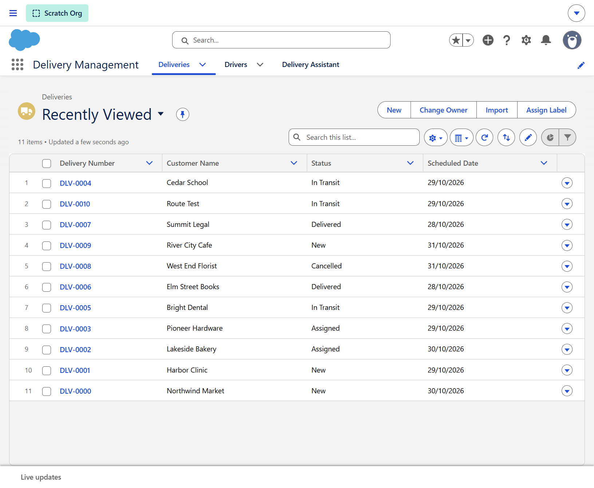
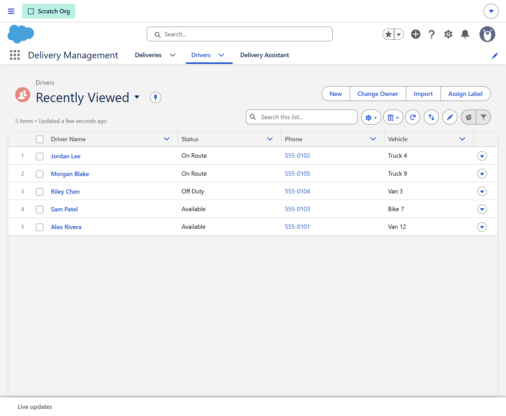
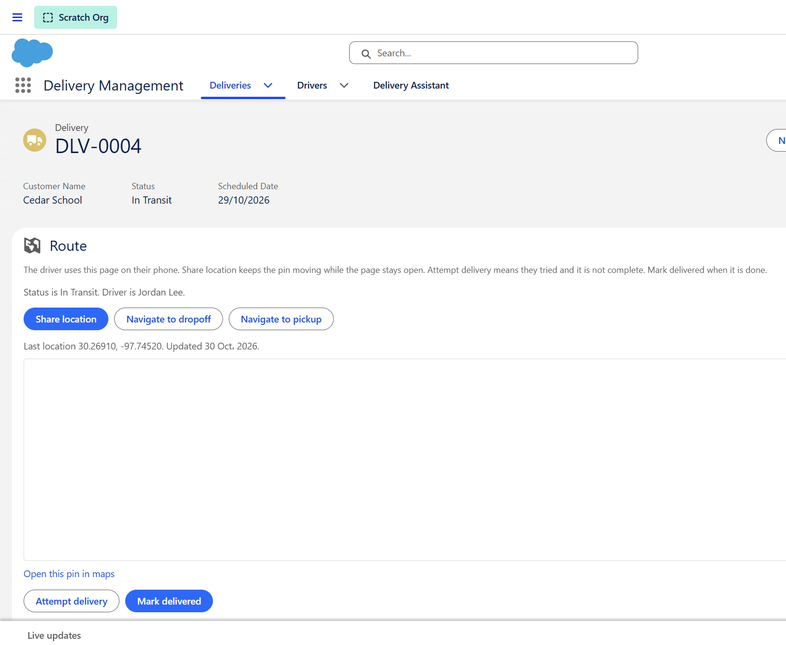
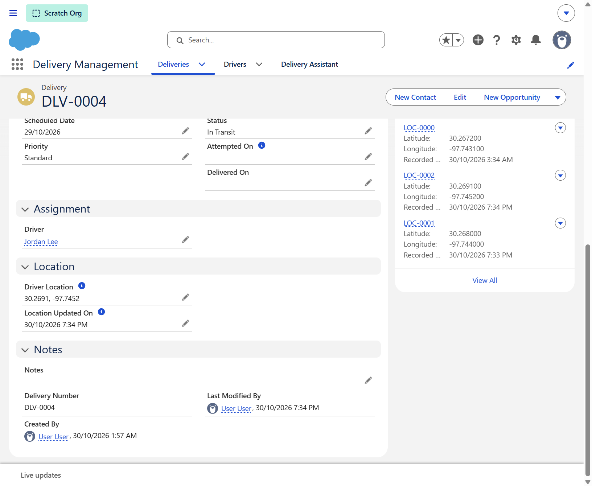
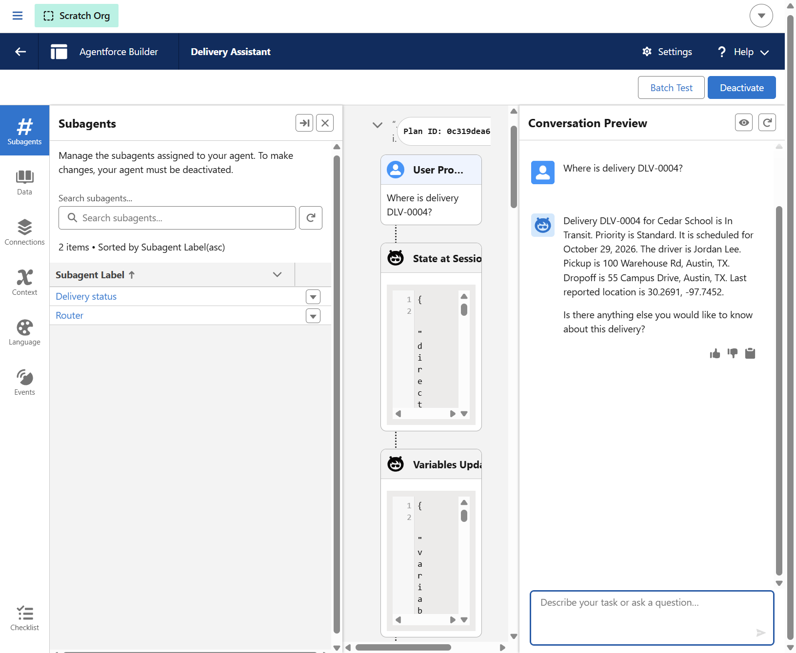
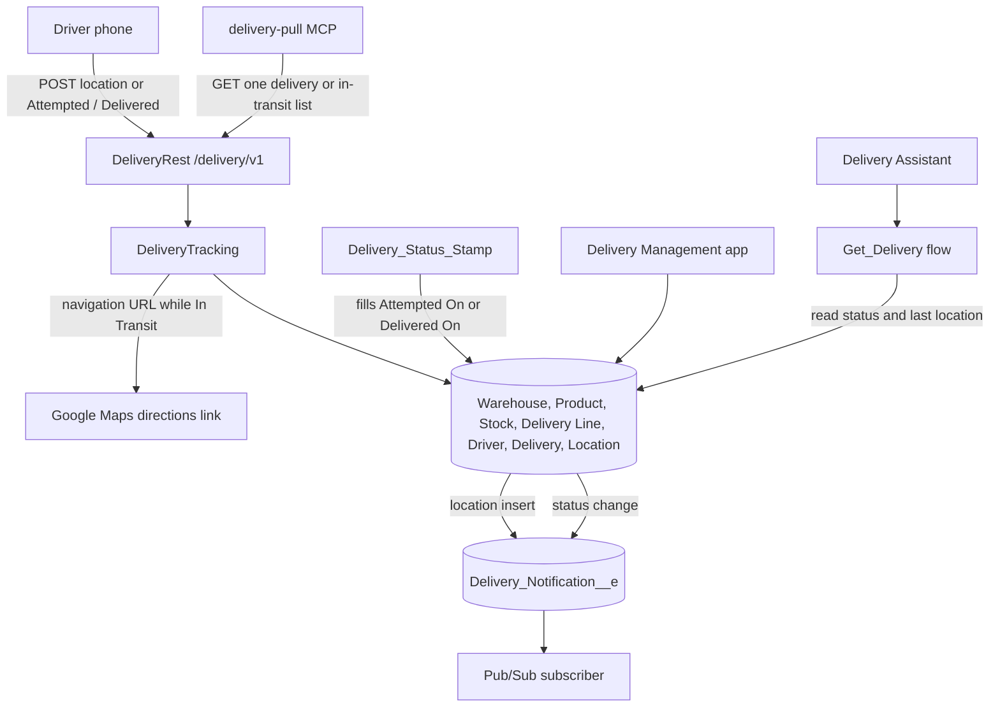

# Delivery Management

Delivery Management is an internal Salesforce app for storing goods in a warehouse, picking and packing an order, then assigning a driver and following the delivery until it is delivered or cancelled.

A warehouse clerk works from Warehouses, Products, Stock, and Delivery Lines. A warehouse has an address and is Open or Closed. A product has a name, SKU, and a unit of Each, Case, or Box. Stock is how many of that product sit in a bin at one warehouse. A delivery line is the quantity of one product on one delivery, and it moves from To Pick, to Picked, to Packed. The clerk updates the quantity on hand when the goods leave the shelf. Packing a line does not change that quantity by itself.

A dispatcher works in the same app once the order is packed. The delivery records which warehouse it leaves from, and a fulfillment of To Pick, Picking, Packed, or Ready. Drivers have a name, phone, vehicle, and a status of Available, On Route, or Off Duty. A delivery has the customer, pickup, dropoff, date, priority, and a status of New, Assigned, In Transit, Attempted, Delivered, or Cancelled. Some stops are not filled from these warehouses, so the warehouse and fulfillment can be left blank.

While a delivery is In Transit, the driver's phone posts GPS to `/services/apexrest/delivery/v1/`. Salesforce stores the latest point on the delivery and the driver, keeps each ping in `Delivery_Location__c`, and returns a Google Maps directions link from that point to the dropoff. The same API accepts Attempted, for a stop that could not be completed, and Delivered, which stamps the completion time. A location post is accepted only while the delivery is In Transit.

A status change or a GPS ping publishes `Delivery_Notification__e` after the save commits. The event carries the delivery number, status, message, coordinates, and the directions link. A subscribed dispatcher page or an outside app is what tells other people. The event can be replayed for 72 hours. The Delivery Assistant and the `delivery-pull` MCP server only read: a delivery number or customer name in, and the status, driver name, addresses, and last reported location out.

## Screens

Deliveries in the Delivery Management app.

Drivers, including who is on route.

The route card on an in-transit delivery. The driver shares a location, records an attempt, or marks the stop delivered from this page.

The same record shows the assigned driver, the latest coordinates, and each stored location ping.

A test of the Delivery Assistant in Agentforce Builder. The question was where DLV-0004 is. The reply quotes the status, driver, addresses, and last reported location.

## Architecture

The warehouse records are the shelf and the pick list. `DeliveryLocationTrigger` publishes a ping after each location row is inserted. `DeliveryTrigger` publishes after a delivery status changes. The MCP server calls the same REST resource and does not post location or status.

## Salesforce DX Project: Next Steps

Now that you’ve created a Salesforce DX project, what’s next? Here are some documentation resources to get you started.

## How Do You Plan to Deploy Your Changes?

Do you want to deploy a set of changes, or create a self-contained application? Choose a [development model](https://developer.salesforce.com/tools/vscode/en/user-guide/development-models).

## Configure Your Salesforce DX Project

The `sfdx-project.json` file contains useful configuration information for your project. See [Salesforce DX Project Configuration](https://developer.salesforce.com/docs/atlas.en-us.sfdx_dev.meta/sfdx_dev/sfdx_dev_ws_config.htm) in the _Salesforce DX Developer Guide_ for details about this file.

## Read All About It

- [Salesforce Extensions Documentation](https://developer.salesforce.com/tools/vscode/)
- [Salesforce CLI Setup Guide](https://developer.salesforce.com/docs/atlas.en-us.sfdx_setup.meta/sfdx_setup/sfdx_setup_intro.htm)
- [Salesforce DX Developer Guide](https://developer.salesforce.com/docs/atlas.en-us.sfdx_dev.meta/sfdx_dev/sfdx_dev_intro.htm)
- [Salesforce CLI Command Reference](https://developer.salesforce.com/docs/atlas.en-us.sfdx_cli_reference.meta/sfdx_cli_reference/cli_reference.htm)
