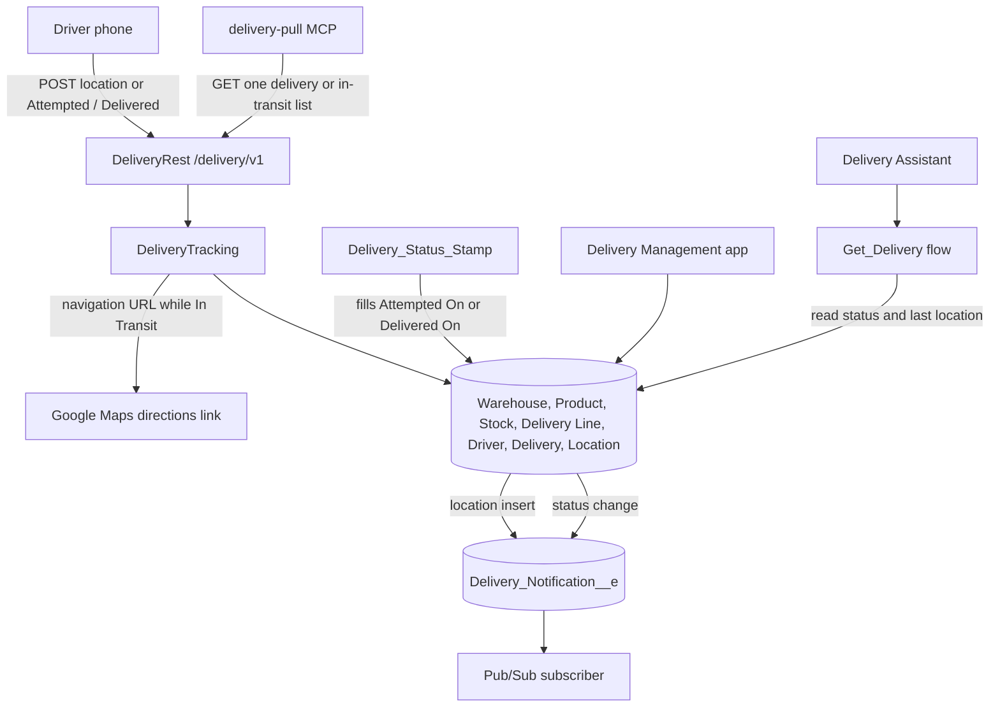

# Delivery Management

Delivery Management is an internal Salesforce app for storing goods in a warehouse, picking and packing an order, then assigning a driver and following the delivery until it is delivered or cancelled.

A warehouse clerk works from Warehouses, Products, Stock, and Delivery Lines. A warehouse has an address and is Open or Closed. A product has a name, SKU, and a unit of Each, Case, or Box. Stock is how many of that product sit in a bin at one warehouse. A delivery line is the quantity of one product on one delivery, and it moves from To Pick, to Picked, to Packed. The clerk updates the quantity on hand when the goods leave the shelf. Packing a line does not change that quantity by itself.

A dispatcher works in the same app once the order is packed. The delivery records which warehouse it leaves from, and a fulfillment of To Pick, Picking, Packed, or Ready. Drivers have a name, phone, vehicle, and a status of Available, On Route, or Off Duty. A delivery has the customer, pickup, dropoff, date, priority, and a status of New, Assigned, In Transit, Attempted, Delivered, or Cancelled. Some stops are not filled from these warehouses, so the warehouse and fulfillment can be left blank.

While a delivery is In Transit, the driver's phone posts GPS to `/services/apexrest/delivery/v1/`. Salesforce stores the latest point on the delivery and the driver, keeps each ping in `Delivery_Location__c`, and returns a Google Maps directions link from that point to the dropoff. The same API accepts Attempted, for a stop that could not be completed, and Delivered, which stamps the completion time. A location post is accepted only while the delivery is In Transit.

A status change or a GPS ping publishes `Delivery_Notification__e` after the save commits. The event carries the delivery number, status, message, coordinates, and the directions link. A subscribed dispatcher page or an outside app is what tells other people. The event can be replayed for 72 hours. The Delivery Assistant and the `delivery-pull` MCP server only read: a delivery number or customer name in, and the status, driver name, addresses, and last reported location out.

## Screens

Deliveries in the Delivery Management app.


Drivers, including who is on route.


The route card on an in-transit delivery. The driver shares a location, records an attempt, or marks the stop delivered from this page.


The same record shows the assigned driver, the latest coordinates, and each stored location ping.


A test of the Delivery Assistant in Agentforce Builder. The question was where DLV-0004 is. The reply quotes the status, driver, addresses, and last reported location.


## Architecture



The warehouse records are the shelf and the pick list. `DeliveryLocationTrigger` publishes a ping after each location row is inserted. `DeliveryTrigger` publishes after a delivery status changes. The MCP server calls the same REST resource and does not post location or status.

## Create a scratch org and deploy

These steps create an empty scratch org, push this project into it, grant access, and load the sample warehouse and deliveries. Run them from the project root, the folder that contains `sfdx-project.json`.

You need the [Salesforce CLI](https://developer.salesforce.com/docs/atlas.en-us.sfdx_setup.meta/sfdx_setup/sfdx_setup_install_cli.htm) (`sf`) and a Dev Hub. In the Dev Hub org, Setup → Dev Hub must be enabled, and the hub must be allowed to create scratch orgs with Einstein and Agentforce. The definition file `config/agentforce-scratch-def.json` turns those features on. The org lasts 30 days. After that, create another one with the same commands.

### 1. Log in to the Dev Hub

```bash
sf org login web --set-default-dev-hub --alias devhub
```

A browser opens. Sign in as a user who can create scratch orgs. The alias `devhub` is only a local name for that login. Later commands use it as the hub that owns the scratch org.

### 2. Create the scratch org

```bash
sf org create scratch --definition-file config/agentforce-scratch-def.json --alias delivery-agent --duration-days 30 --set-default
```

Salesforce provisions a new Developer org named Delivery Management Agent and prints a username such as `test-something@example.com`. The alias `delivery-agent` is how every later command refers to it. `--set-default` makes that alias the default target, so you can omit `--target-org` if you want. Creation often takes a few minutes.

If the alias is already in use, pick another name, for example `delivery-agent-2`, and use that name in the commands below.

`config/project-scratch-def.json` creates a Developer org without Einstein. Use it only when the Dev Hub cannot enable Agentforce. The Delivery Assistant bundle in this project then fails to deploy. The warehouse, delivery, and Place Order metadata can still deploy to that org if the agent bundle is left out of the deploy.

### 3. Deploy the project

```bash
sf project deploy start --target-org delivery-agent
```

This pushes `force-app`: the warehouse, product, stock, driver, and delivery objects, the Delivery Management app, the Place Order tab, Apex, flows, and the Delivery Assistant. Wait until the command reports a successful deploy. The first deploy can take several minutes.

To run the Apex tests as part of the same deploy:

```bash
sf project deploy start --target-org delivery-agent --test-level RunLocalTests
```

### 4. Assign the permission set

```bash
sf org assign permset --name Delivery_Management --target-org delivery-agent
```

The scratch org user can sign in without this, and still cannot open the app. `Delivery_Management` grants the app, the tabs (including Place Order), the objects, and the Apex classes `DeliveryTracking`, `DeliveryRest`, and `OrderCatalog`. It does not grant Agentforce. The flows `Get_Delivery` and `Delivery_Assistant` are included, and the agent still will not open until the next step.

### 5. Assign Agentforce so the assistant can run

The scratch definition enables Einstein and the agent platform. It does not put those licenses on the user. Assign the licenses first, then the permission sets. These are standard Salesforce sets created with the org. They are not files in this project.

```bash
sf org assign permsetlicense --name EinsteinGPTCopilotPsl --name AgentPlatformBuilderPsl --name EinsteinGPTPromptTemplatesPsl --target-org delivery-agent
sf org assign permset --name CopilotSalesforceUser --name AgentPlatformBuilder --name EinsteinGPTPromptTemplateUser --target-org delivery-agent
```

| License | Permission set | What it lets you do |
| --- | --- | --- |
| `EinsteinGPTCopilotPsl` (Agentforce Default) | `CopilotSalesforceUser` (Access Agentforce Default Agent) | Open the agent and ask it a question |
| `AgentPlatformBuilderPsl` | `AgentPlatformBuilder` | Open Agentforce Builder and test the Delivery Assistant |
| `EinsteinGPTPromptTemplatesPsl` | `EinsteinGPTPromptTemplateUser` | Let the agent run its prompt templates |

Skip this step only when you used `config/project-scratch-def.json` and are not deploying the agent.

### 6. Load the sample data

```bash
sf data import tree --plan data/sample-data-plan.json --target-org delivery-agent
```

The plan inserts records in this order, because later files point at earlier ones:

| File | What it loads |
| --- | --- |
| `data/drivers.json` | Five drivers: Alex Rivera, Jordan Lee, Sam Patel, Riley Chen, Morgan Blake |
| `data/warehouses.json` | Austin Main (`100 Warehouse Rd`) and Supply Court (`18 Supply Court`) |
| `data/products.json` | Seven products, including Paper Towels (`PT-100`) and Dental Bibs (`DN-600`) |
| `data/deliveries.json` | Ten deliveries. Cedar School is In Transit from Austin Main |
| `data/stock.json` | Shelf counts and bins. Screws at Austin Main and exam gloves at Supply Court are at 5 or below |
| `data/delivery-lines.json` | Pick lines for the warehouse deliveries |

On a new org the auto-numbers start at `DLV-0000`. Northwind Market is `DLV-0000`. Cedar School is `DLV-0004`. Lakeside Bakery and West End Florist have no warehouse, because those pickups are not from Austin Main or Supply Court.

Run the import once. Running it again inserts a second copy of the drivers, products, warehouses, and deliveries.

### 7. Open the org

```bash
sf org open --target-org delivery-agent
```

To land on Place Order:

```bash
sf org open --target-org delivery-agent --path /lightning/n/Place_Order
```

In the app launcher, open **Delivery Management**. The tabs are Place Order, Deliveries, Drivers, Warehouses, Products, Stock, Delivery Lines, and Delivery Assistant.

Check these after the import:

- **Place Order** lists products that are on hand. Adding Paper Towels chooses Austin Main. Dental Bibs stay visible and cannot be added to that order, because they are only at Supply Court.
- **Stock** has an All Stock list and a Low Stock list.
- **Deliveries** shows `DLV-0004` for Cedar School, In Transit, fulfillment Ready, driver Jordan Lee.
- **Delivery Assistant**, in Agentforce Builder, can answer “Where is the Cedar School delivery?” after the licenses and permission sets in step 5 are assigned.

The public customer site is not created by this deploy. Place Order is a tab inside the app so the order component can be tested first.

### Use the org again later

```bash
sf org list
sf org open --target-org delivery-agent
sf org display --target-org delivery-agent
```

`sf org list` shows the alias, the username, and the expiration date. `sf org display` shows the instance URL and the remaining days.

The `delivery-pull` MCP server reads this org through the Salesforce CLI. In `.cursor/mcp.json`, `DELIVERY_TARGET_ORG` must be the alias from step 2. The file already uses `delivery-agent`. Change it if you chose a different alias, then restart the MCP server in Cursor.
